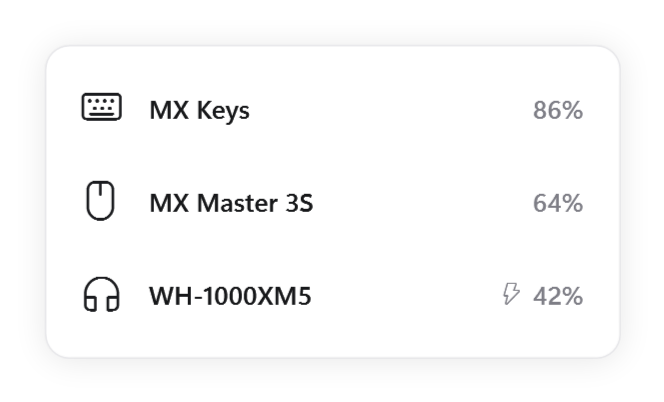
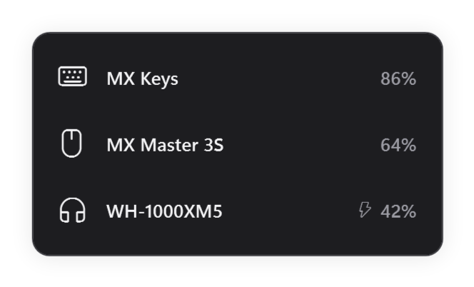
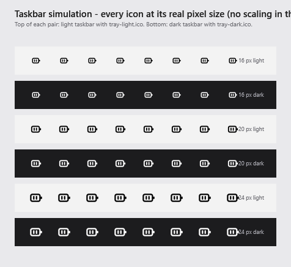

# Watt — 外设电量悬浮窗

当前版本：**2.1.0**

Windows 11 托盘小工具：左键点击托盘图标，在屏幕右下角弹出一块干净的悬浮窗，显示当前已连接外设（键盘、鼠标、蓝牙耳机等）的电量。开机自启，常驻托盘，不占任务栏。



## 功能

- **开机自启**：安装时注册当前用户登录自启（`HKCU\...\Run`），无管理员权限。
- **托盘常驻**：左键托盘图标切换悬浮窗；右键只有两项：`开机自启`、`退出 Watt`。图标会自动固定到**一级通知区域**（与输入法、网络、音量平级），不会藏进 `^` 溢出区。
- **悬浮窗**：右下角浮层，随内容自适应高度；点击别处或按 `Esc` 关闭。
- **插件化电量来源**：每种读取方式都是独立插件 DLL，宿主并行调度、统一缓存与合并；默认内置 Windows 标准蓝牙与 BLE GATT 两种来源。未适配设备可按 [插件开发文档](docs/plugins.md) 写一个 DLL 放入 `plugins` 或 `%LOCALAPPDATA%\Watt\plugins`，无需改主程序。
- **休眠保留**：外设休眠、暂时不响应或蓝牙耳机断开时，悬浮窗保留最后一次读到的电量并继续显示该设备；设备被拔除/取消配对后才移除；应用重启也会从本地缓存恢复。
- **系统原生观感**：图标使用 Windows 11 自带的 Segoe Fluent Icons 线性图标；托盘图标为自绘黑色线稿（深色任务栏自动切换白色），透明背景。
- **跟随主题**：悬浮窗与托盘图标自动跟随系统浅色/深色模式。
- **克制的细节**：电量 ≤ 15% 时数字变红，充电时显示小闪电；除此之外没有任何标语、提示、标签或二级菜单。

| 深色模式 | 无设备时 |
| --- | --- |
|  |  |

托盘图标（16 / 20 / 24 px，浅色与深色任务栏实拍）：



### 内置电量插件

| 插件 Id | 优先级 | 超时 | 写设备 | 数据来源 |
| --- | --- | --- | --- | --- |
| `windows-aep` | 10 | 3000 ms | 否 | Windows 蓝牙 AEP 属性（`System.Devices.BatteryLife` / `BatteryPlusCharging`），并对经典蓝牙耳机回退读取 HFP 设备节点电量 |
| `ble-gatt` | 20 | 6000 ms | 否 | 已连接 BLE 设备的标准 Battery Service（`0x180F / 0x2A19`） |

优先级数字越小越优先；第三方插件建议使用 ≥ 60，避免覆盖内置来源。厂商私有协议（2.4G dongle、厂商 HID 协议、厂商查询帧等）默认不内置，需要时通过插件扩展。

## 工作原理

```
              ┌──────────────────────────────┐
              │  PluginHost                  │
              │  <app>\plugins\*.dll         │
              │  %LOCALAPPDATA%\Watt\plugins │
              │  --plugin-dir <dir>          │
              └──────────────┬───────────────┘
                             │ 加载 IBatteryPlugin
                             ▼
┌───────────┐      并行调用、按超时回收      ┌────────────────────┐
│ 键盘/鼠标 │ ◄────────────────────────────► │  BatteryService    │
│ 耳机/接收器│       PluginReadResult         │  60 秒扫描一次      │
└───────────┘                                └─────────┬──────────┘
                                                       │ 合并 / 去重 / 缓存
                                                       ▼
                                             ┌────────────────────┐
                                             │  LastKnownStore    │
                                             │  last-known.json   │
                                             └─────────┬──────────┘
                                                       │ 设备列表
                                                       ▼
                                             ┌────────────────────┐
                                             │  托盘 + 悬浮窗 UI   │
                                             └────────────────────┘
```

### 插件加载

- `<安装目录>\plugins`：内置插件；
- `%LOCALAPPDATA%\Watt\plugins`：第三方插件（升级/重装 Watt 不会覆盖）；
- `--plugin-dir <dir>`：开发/测试时临时追加；
- 按目录顺序加载，同一插件 Id 后加载的覆盖先加载的；加载失败的 DLL 只记录错误，不影响主程序和其他插件；
- 插件实例在进程内运行，随 Watt 退出而结束；当前**没有热加载**，替换 DLL 后必须重启 Watt。

### 一次扫描

1. `BatteryService` 在启动时立即扫描一次，之后每 **60 秒**扫描一次；打开悬浮窗时如果距上次刷新超过 10 秒也会触发一次；
2. 所有插件**并行**执行 `ReadAsync`，每个插件最多等待其 `SuggestedTimeoutMs`（宿主限制在 500–15000 ms）；
3. 插件返回 `PluginReadResult`：
   - `Absent()`：传输不存在（接收器拔出、蓝牙关闭等）。连续 **3 次** absent 后，宿主删除该插件名下的缓存设备；
   - `Observed(devices)`：传输在线。带电量的是新读数，写入缓存；`BatteryPercent = null` 表示“设备在但暂时没读数”，宿主用最后一次缓存值保留这一行；
   - 超时/异常：保留该插件此前的缓存行，且**不**计入 absent（慢设备不等于被拔掉）。
4. 宿主按规范化蓝牙地址或设备名称合并多个来源的结果；同一设备有多个来源时，Priority 小的优先；新读数优先于旧缓存；最后按设备类型/名称排序输出给界面；
5. 只有能拿到电量（新读数或缓存）的设备才会显示。

### 持久化

| 路径 | 内容 |
| --- | --- |
| `%LOCALAPPDATA%\Watt\last-known.json` | 最后一次成功读到的电量，保留 30 天；应用重启后仍可显示休眠设备 |
| `%LOCALAPPDATA%\Watt\plugin-data\<plugin-id>\` | 插件自己的可写数据目录（可选） |
| `<Watt 安装目录>\watt-startup.log` | 运行日志、插件加载/错误日志 |

## 安装

要求：Windows 11 x64，自带 .NET Framework 4.8 即可运行，无需安装任何运行时，**不需要管理员权限**。

从发布页下载并解压后，目录中应包含 `Watt.exe`、`Watt.exe.config`、`Watt.Plugin.Contracts.dll`、`Watt.Plugin.Support.dll`、`Watt.Setup.exe`、`plugins\`、`install.cmd`、`uninstall.cmd`。安装不需要 PowerShell，也不修改执行策略；双击 `install.cmd`，或在命令提示符中执行：

```cmd
install.cmd
```

`Watt.Setup.exe` 会：

- 复制程序运行时文件到 `%LOCALAPPDATA%\Programs\Watt\`（含 `plugins\`）；
- 注册开机自启（`HKCU\Software\Microsoft\Windows\CurrentVersion\Run` 的 `Watt` 值）；
- 创建开始菜单快捷方式 `Watt.lnk`；
- 启动 Watt。

可选参数直接传给 `install.cmd`，例如 `install.cmd --no-start`、`install.cmd --install-dir D:\Apps\Watt`。也可以直接运行 `Watt.Setup.exe install`。

之后每次登录 Windows，Watt 会自动出现在托盘。第三方插件放在 `%LOCALAPPDATA%\Watt\plugins\` 即可，不需要改安装目录。

## 使用

- **左键**托盘图标：显示 / 隐藏悬浮窗。
- **点击悬浮窗以外**或按 `Esc`：关闭悬浮窗。
- **右键**托盘图标：勾选/取消「开机自启」，或「退出 Watt」。
- 悬浮窗打开时会自动刷新一次电量；后台每 60 秒静默扫描，不弹窗、不打扰。

## 卸载

在解压后的发行版目录中双击 `uninstall.cmd`，或在命令提示符中执行：

```cmd
uninstall.cmd
```

会停止进程、删除自启项、删除开始菜单快捷方式、`%LOCALAPPDATA%\Programs\Watt`，以及 `%LOCALAPPDATA%\Watt` 下的缓存/第三方插件数据。确认提示可以输入 `y`；非交互场景使用 `uninstall.cmd --yes --keep-data` 保留缓存与用户插件。

## 从源码构建

需要 .NET SDK 9 与 Windows 10/11 SDK 的 `Windows.winmd`（默认查找
`C:\Program Files (x86)\Windows Kits\10\UnionMetadata\10.0.26100.0\Windows.winmd`，
可用 `-p:WinmdPath=...` 覆盖）。构建完全离线，不需要 NuGet，也不使用 PowerShell：

```cmd
cd watt
build.cmd
```

`build.cmd` 会依次构建：

- `src/Watt`（宿主）；
- `src/Watt.Setup`（安装/卸载程序）；
- `src/Watt.Plugin.Contracts`、`src/Watt.Plugin.Support`（插件 SDK）；
- `src/Watt.Plugins.*`（内置插件）；
- 把完整发行版汇总到带版本号的目录，并生成 zip：

```
dist\Watt-2.1.0-win-x64\
├─ Watt.exe
├─ Watt.exe.config
├─ Watt.Plugin.Contracts.dll
├─ Watt.Plugin.Support.dll
├─ Watt.Setup.exe              # C# 安装/卸载程序，无需 PowerShell
├─ install.cmd
├─ uninstall.cmd
├─ plugins\
│  ├─ Watt.Plugins.Windows.dll
│  └─ Watt.Plugins.BleGatt.dll
├─ README.md
└─ docs\
```

构建完成后安装：

```cmd
cd dist\Watt-2.1.0-win-x64
install.cmd
```

仓库根目录只负责构建，不包含安装/卸载入口；安装和卸载脚本只存在于构建产物目录中。更详细的构建/安装/卸载说明见 [docs/install.md](docs/install.md)。

## 插件开发

完整契约、生命周期、缓存语义和排错方式见 **[docs/plugins.md](docs/plugins.md)**。

- 示例插件：[sdk/sample/Watt.Plugin.Sample/](sdk/sample/Watt.Plugin.Sample/)（返回一台虚拟的 42% 键盘，用于验证加载链路）；
- 插件开发资料：[sdk/README.md](sdk/README.md)、[sdk/AI-PROMPT.md](sdk/AI-PROMPT.md)、[sdk/capture-template.md](sdk/capture-template.md)、[sdk/ACCEPTANCE.md](sdk/ACCEPTANCE.md)；
- 契约源码：`src/Watt.Plugin.Contracts/`；HID/WinRT 辅助：`src/Watt.Plugin.Support/`。

最少步骤：

1. 用 `Watt.exe --diagnose report.txt` 确认设备需要新插件，并采集 VID/PID、usage、报文和电量字段；
2. 参考 `sdk/sample/Watt.Plugin.Sample/` 新建 net48 类库，实现 `IBatteryPlugin`（通常继承 `BatteryPluginBase`）；
3. `dotnet build <工程>.csproj -c Release`；
4. 把 DLL 复制到 `%LOCALAPPDATA%\Watt\plugins`，重启 Watt；
5. 用 `--plugins`、`--selftest`、`--diagnose` 验证。

注意：插件以进程内完全信任代码运行，只安装可信来源的 DLL；不要引用 NuGet 外部包；不要自己维护缓存/删除逻辑。

## 开发与调试

编译出的 `Watt.exe` 内置若干诊断模式（不影响正常使用）：

| 参数 | 作用 |
| --- | --- |
| `--selftest <file.json>` | 加载插件、扫描一次外设并输出 JSON 后退出，用于排查「为什么没显示某设备」 |
| `--plugins <file.txt>` | 列出插件搜索目录、已加载插件、元数据与加载错误 |
| `--diagnose <file.txt>` | 输出本机蓝牙/2.4G/HID/电量节点/各插件执行结果的诊断报告 |
| `--plugin-dir <dir>` | 额外插件目录（可重复，或以 `;` 分隔），供开发/测试加载第三方插件 |
| `--snapshot <dir>` | 离屏渲染悬浮窗各种状态为 PNG（设计迭代用），无需显示器 |
| `--panel [--dark] [--empty] [--panel-seconds N]` | 直接预览悬浮窗 |
| `--demo [--close-after N]` | 托盘 + 悬浮窗使用假数据运行，便于截图 |
| `--close-after N` | 正常托盘模式运行 N 秒后自动退出（自动化测试用） |

运行日志写在 exe 同目录的 `watt-startup.log`。

## 目录结构

```
watt/
├─ src/
│  ├─ Watt/                     # net48 WPF 托盘程序（宿主）
│  │  ├─ App.xaml(.cs)          # 生命周期、单实例、托盘/悬浮窗/插件加载
│  │  ├─ Battery/               # BatteryService 调度、合并、LastKnownStore
│  │  ├─ Plugins/               # PluginHost：发现/加载内置与第三方插件
│  │  ├─ Services/              # 自启、单实例、主题监听
│  │  ├─ Tray/                  # 托盘图标、右键菜单、一级托盘固定
│  │  ├─ UI/                    # 悬浮窗、面板、主题、图标字形
│  │  └─ Diagnostics/           # --snapshot / --diagnose
│  ├─ Watt.Setup/               # C# 安装/卸载程序；templates 下是发行版 cmd 包装器
│  ├─ Watt.Plugin.Contracts/    # 公共插件 SDK（模型 + IBatteryPlugin 接口）
│  ├─ Watt.Plugin.Support/      # 插件复用库（HID、WinRT、设备分类、HFP 读取）
│  ├─ Watt.Plugins.Windows/     # 内置插件：Windows AEP + HFP 节点
│  └─ Watt.Plugins.BleGatt/     # 内置插件：BLE GATT 0x180F/0x2A19
├─ sdk/                         # 插件开发资料：提示词、采集模板、验收清单、示例
│  └─ sample/Watt.Plugin.Sample/ # 可构建的示例第三方插件
├─ tools/IconGen/               # 托盘/应用图标生成器（矢量 → 多尺寸 ICO）
├─ assets/                      # 托盘/应用图标与设计预览
├─ docs/                        # 安装、插件契约、设备支持、图标说明
├─ build.cmd                    # 构建并生成 dist\Watt-<version>-win-x64
├─ README.md
└─ .gitignore
```

`dist/` 是 `build.cmd` 生成的发行版目录/zip，不在仓库中提交；安装和卸载入口只出现在发行版目录里。

## 已知限制

- 只显示被插件观察到、且能读到电量（或已有缓存）的设备；从未上报过电量的设备不会出现。
- Windows AEP 的电量可能由 Windows 自己缓存，休眠时显示的是最后一次值；蓝牙经典耳机能否显示取决于 Windows 或耳机固件是否上报（本机实测 EDIFIER Fit900NB 走 HFP 节点读取）。
- 厂商私有协议（2.4G dongle、厂商 HID 协议、厂商查询帧等）默认不内置；需要时通过插件扩展，见 [插件开发文档](docs/plugins.md) 与 [支持设备与数据来源](docs/supported-devices.md)。
- 本项目的构建、UI、托盘、自启与安装脚本已在 Windows 11 上验证；本机已实测标准蓝牙耳机 EDIFIER Fit900NB 的 HFP 节点电量，其他型号仍需实机确认。
- 程序无网络访问、无遥测；只读取本机蓝牙/HID 设备 API、写入自启注册表项、日志和本地缓存。
- 托盘图标置顶依赖 Windows 11 的通知区域设置（`HKCU\Control Panel\NotifyIconSettings` 的 `IsPromoted`）。如果系统策略或第三方任务栏工具拦截，可能需要重启一次 Explorer 或重新登录后生效；设置本身会自动重试。
- 悬浮窗固定出现在主显示器（任务栏所在屏幕）的右下角；多显示器下不会跟随副屏任务栏。
- 插件是进程内完全信任代码，没有沙箱；当前没有热加载/卸载机制。

## 技术说明

- 目标框架 .NET Framework 4.8（Windows 11 自带），WPF + WinForms（仅用于 `NotifyIcon`），x64；主程序约 240 KB，另有插件 SDK DLL 与内置插件。
- **插件架构**：`PluginHost` 从 `<安装目录>\plugins`、`%LOCALAPPDATA%\Watt\plugins` 和 `--plugin-dir` 加载 DLL；每个插件实现 `IBatteryPlugin.ReadAsync`，返回“观察到的设备 + 是否在线”，不直接写缓存。宿主负责并行调度、超时、按 Priority 合并去重、LastKnownStore 持久化，以及连续 3 次 `HardwarePresent=false` 后清理该插件的缓存设备。完整契约见 [docs/plugins.md](docs/plugins.md)。
- WinRT 蓝牙 API 通过本地 `Windows.winmd` 直接引用；`WinRtAsync` 适配器把 `IAsyncOperation<T>` 转成 `Task<T>`，放在 `Watt.Plugin.Support` 供插件复用。
- 经典蓝牙 HFP 节点电量通过 SetupAPI 读取 `DEVPKEY_Device_BatteryLevel`；第三方插件可以使用 `Watt.Plugin.Support` 中的 HID 封装实现自己的协议。
- 图标：面板使用系统 `Segoe Fluent Icons`（与 Windows 11 设置页同源）；托盘图标由 `tools/IconGen` 矢量绘制并逐尺寸渲染，保证 16 px 下仍是清晰的黑色线稿。
- 单实例：命名互斥体 `Local\Watt.SingleInstance` + 激活事件；重复启动只会唤出已有实例的悬浮窗。
- 插件以进程内完全信任代码运行；只安装可信来源的插件 DLL。
- 设备支持与数据来源（含 HFP 方法来源署名）：[docs/supported-devices.md](docs/supported-devices.md)。
